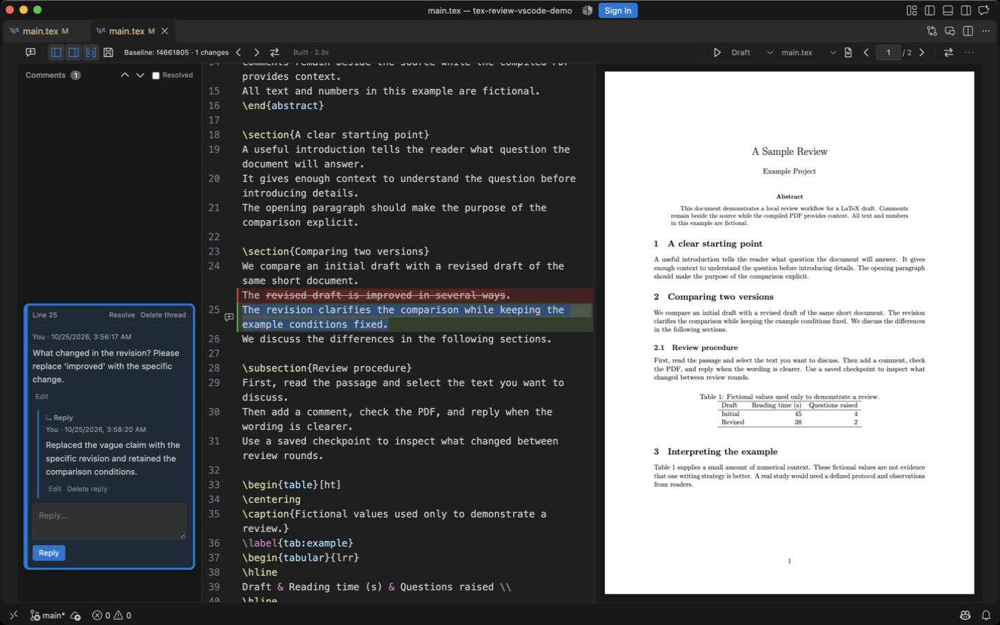
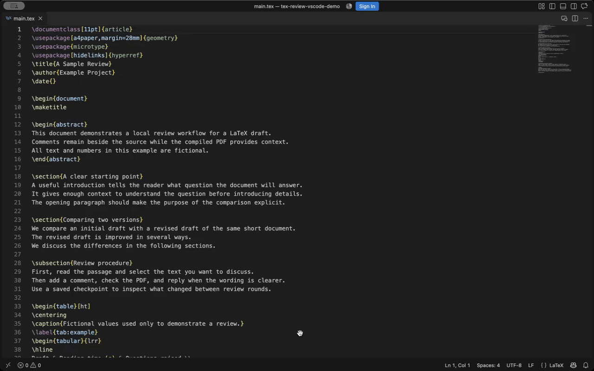

# TeX Review Studio

A VS Code / Cursor extension for LaTeX editing, PDF preview, and review comments
anchored to the source text.



## Install

[Install from the Visual Studio Marketplace](https://marketplace.visualstudio.com/items?itemName=yumizsui.tex-review).

## Features

- One manuscript tab for TeX source, threaded comments, and PDF preview.
- A comment list grouped by source file, with search, comment types, AI reply filters, and navigation across included TeX files.
- Text and Markdown files reviewed without the PDF pane.
- Stable local links to individual comment threads.
- PDF builds and bidirectional source–PDF navigation through SyncTeX.
- Comparison against a Git commit or another file.
- Comments and replies exported as PDF annotations.
- Review files that AI coding assistants can read and answer.

## Demo



## Build from source

Build a VSIX from source with **Node.js 22.12 or later**:

```sh
npm ci --ignore-scripts
mkdir -p releases
npm run package -- --out releases/tex-review.vsix
```

Run **Extensions: Install from VSIX…** in VS Code or Cursor and select the
resulting file.

PDF builds require a local TeX installation with `latexmk`, `synctex`, and a TeX
engine. LuaLaTeX is the default; pdfLaTeX and XeLaTeX are also supported. Git is
required for comparisons against a commit.

## Use

Open a `.tex`, `.txt`, or `.md` file with **TeX Review: Open review editor**. Select a passage and
press **⌘⌥M** (macOS) or **Ctrl+Alt+M** (Windows/Linux) to add a comment.

AI assistants can change reviewed text and its comment destinations together
through the [local editing API](docs/AI_EDITING.md), or read and answer comments
through the [review-file guide](skills/review-comments/SKILL.md).

## Limitations

The review editor uses a separate editing surface. Native-editor integrations,
including LaTeX Workshop completion and Cursor inline suggestions, are not
available in this view. **Review options → Open in standard editor** returns to
the standard editor.

Source–PDF navigation requires matching SyncTeX data. Comment positions may need
manual reattachment after substantial source changes. Use one editor window per
review store.

## Development

Run `npm test` and `npm run compile` to check a change. `npm run build` builds the
extension.

## License

MIT. See [LICENSE](LICENSE) and [third-party notices](THIRD_PARTY_NOTICES.md).
